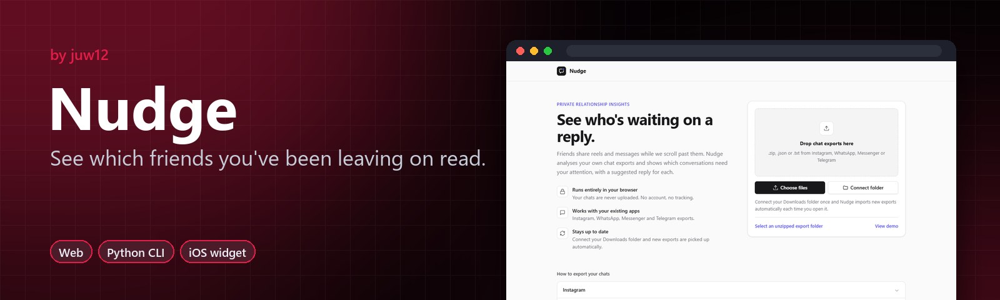
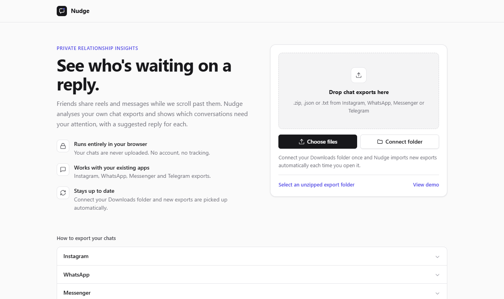

<!-- HERO:START -->
<p align="center">
  <a href="https://juw12.github.io/nudge/"></a>
</p>

<p align="center">
  <b>See which friends you've been leaving on read.</b><br>
  Nudge reads your own chat exports and hands you a ready-to-send opener to reconnect.
</p>

<p align="center">
  <a href="https://juw12.github.io/nudge/"><b>Try it live</b></a> ·
  <a href="#see-it-in-action">See it in action</a> ·
  <a href="#highlights">Highlights</a> ·
  <a href="https://github.com/juw12">More by juw12</a>
</p>

<p align="center">
  <a href="https://github.com/juw12/nudge"></a>
  <a href="https://juw12.github.io/nudge/"></a>
  
  
  
  
</p>

<a id="highlights"></a>
<table>
  <tr>
    <td width="33%" valign="top">
      <b>Your exports, your machine</b><br>
      Instagram, WhatsApp, Telegram and iMessage exports, analysed 100% locally.
    </td>
    <td width="33%" valign="top">
      <b>Who's waiting on you</b><br>
      Unanswered shares and fading friendships, ranked.
    </td>
    <td width="33%" valign="top">
      <b>A nudge each week</b><br>
      A weekly digest, an iOS widget and a ready-to-send opener.
    </td>
  </tr>
</table>

## See it in action

<p align="center">
  <a href="https://juw12.github.io/nudge/"></a><br>
  <sub>Open the interactive demo at <a href="https://juw12.github.io/nudge/">juw12.github.io/nudge/</a></sub>
</p>
<!-- HERO:END -->

## About

**Your friends keep sending you reels. You keep scrolling past them.**

`nudge` reads your own chat exports (Instagram, Messenger, WhatsApp, Telegram) and shows you
who has been reaching out while you weren't really there. You get a short, kind to-do list for
your friendships:

```
  Friends sent you 54 reels/posts/links. You responded to 36 (67%).
  12 still unanswered · 4 people waiting on a reply.

   #  friend           app        shared you resp. pending  waiting  you last
   1  Maya Chen        instagram      27       52%       8   12 msg   10d ago
   2  Priya Nair       instagram       3        0%       3    9 msg     never
   ...
  Reach back today:
   → Maya sent you 8 things you never answered. Watch the newest reel and say what it
     reminded you of. Something more than 😂.
     try: "just binged everything you sent me lol. that last reel 💀 when are we hanging out?"
```

It also writes a self-contained HTML page ("Who's waiting on you") with clickable links to every
unanswered reel and a copy button for the opener.

## Use the app

**👉 [juw12.github.io/nudge](https://juw12.github.io/nudge/)** · [try the demo](https://juw12.github.io/nudge/?demo=1)

Drop your Instagram, WhatsApp, Messenger or Telegram export in the page. Nudge reads it **inside your
browser**: nothing is uploaded, and there's no account or server.

* **Install it.** On a phone, tap *Share → Add to Home Screen* (iPhone) or *Install app* (Android). On a
  computer, use the install icon in Edge or Chrome's address bar. Once installed it works offline, and
  on Windows you can right-click a chat export and choose *Open with → nudge*.
* **No dragging after the first time:**
  * **Computer (Edge / Chrome):** click **📁 Connect Downloads folder** once. Each time you open nudge it
    picks up the newest Instagram, Messenger, WhatsApp and Telegram exports from that folder by itself.
    In the installed app, choose *Allow on every visit* and it's fully automatic.
  * **Android:** install nudge, then in WhatsApp tap *Export chat → nudge*. It lands in the app directly.
  * **Everywhere:** nudge remembers every chat you've added and merges new ones in, so you only ever add
    what's new. It keeps who-sent-what-when and links only, never message text, and only on your device.
* **Open it before you open a feed.** Tap **✓ Replied** as you catch up. When that friend messages
  again in a later export, they come back.
* **Different name per app?** Pick "You on WhatsApp / Instagram / …" if it guessed wrong.

The app lives in `docs/` (plain HTML + JavaScript, no build step). The command-line tool below adds
iMessage, scheduled weekly digests and desktop notifications.

## Why

Tech keeps getting better at connecting us, but people feel more disconnected than ever. A reel
sent in a DM is often a small *"I thought of you."* It gets buried under the same infinite feed it
came from. Existing tools don't cover this:

| Project | What it does | What's missing |
|---|---|---|
| [Monica](https://github.com/monicahq/monica) (~25k ★) | Personal CRM, reminders to call people | Manual data entry; never sees who actually messaged you |
| PingCRM | AI follow-ups for professional networking | Built for contacts and leads, not friends |
| Scrolless and other blockers | Block Reels and Shorts | Cut the scrolling but don't point you back to people |

nudge measures one thing: **attention people gave you that you never returned.**

## Privacy

* 100% local. No network calls, no accounts, no telemetry. Pure Python standard library.
* It only reads exports **you** download from your own accounts.
* There's no scraping and no unofficial APIs, so it doesn't break any platform's terms.

## Install

```bash
git clone https://github.com/juw12/nudge && cd nudge
pip install .          # or run in place with: python -m nudge ...
nudge demo --open  # try it on fake data first
```

Requires Python 3.10+.

## Get your data

| App | How to export | Pass to nudge |
|---|---|---|
| Instagram | Settings → Accounts Center → Your information and permissions → Download your information → **Messages**, format **JSON** | the `.zip` or unzipped folder |
| Messenger | Same flow under Facebook, format **JSON** | the `.zip` or folder |
| WhatsApp | Open a chat → ⋮ / contact name → **Export chat** → *Without media* | each `.txt` (or a folder of them) |
| Telegram | Telegram Desktop → Settings → Advanced → **Export Telegram data** → *Machine-readable JSON* | `result.json` |
| iMessage / SMS (iPhone on Windows) | iTunes or Apple Devices → back up iPhone **to this computer**, with *Encrypt local backup* **off** | the keyword `imessage` (finds the newest backup), or the backup folder |
| iMessage (Mac) | Nothing to export. Give your terminal **Full Disk Access** | `imessage` (reads `~/Library/Messages/chat.db`) |

```bash
nudge scan ~/Downloads/instagram-export.zip "~/Downloads/WhatsApp Chat with Maya.txt" \
    --me "Sam Rivera" --days 30 --html report.html --open
```

`--me` is optional for Instagram, Messenger and Telegram, where you're auto-detected as the person in
the most threads. It's **needed for a single WhatsApp chat**, because both people appear exactly once.
You can repeat it if your name differs between apps.

iMessage only has phone numbers and emails. Add `--contacts contacts.vcf` (exported from iCloud Contacts, Google Contacts or your phone) to see names instead.

### Options

| Flag | Default | Meaning |
|---|---|---|
| `--days` | 30 | Look-back window |
| `--reply-window-hours` | 48 | A reply within this time counts as responding to a share |
| `--include-groups` | off | Analyse group chats too (1:1 only by default) |
| `--as-of YYYY-MM-DD` | newest message | Pretend "today" is this date |
| `--whatsapp-date-order` | auto | `dmy` / `mdy` / `ymd` if auto-detection guesses wrong |
| `--json FILE` | | Machine-readable output for widgets, bots or dashboards |

## Weekly digest + desktop notification

```bash
nudge digest imessage ~/Downloads/instagram-export.zip --notify --open
```

This prints a five-line summary, writes `digest.html` and `status.json`, and can pop a desktop
notification ("Maya + 3 others are waiting on you"). The default window is the last **7** days. If your
newest message is more than a week old, it reminds you to download a fresh export. iPhone backups
refresh on their own every time your phone syncs, so iMessage stays current with no effort.

Run it automatically every week:

```bash
nudge schedule imessage ~/Downloads/instagram-export.zip --day SUN --time 19:00
nudge schedule ... --dry-run     # see exactly what would be registered
nudge unschedule
```

* **Windows:** creates a Task Scheduler task called `nudge-weekly-digest`.
* **macOS / Linux:** prints the `crontab` line to add.

## Phone widget: "3 people are waiting on you" before you open a feed

The digest writes a small `status.json`. Point `--out` at any folder that syncs to your phone, such as
iCloud Drive, OneDrive or Dropbox:

```bash
nudge schedule imessage --out "C:\Users\you\iCloudDrive\nudge"
```

**iPhone (Scriptable, free):**

1. Install [Scriptable](https://scriptable.app). Copy `widgets/nudge-widget.js` into it.
2. Go to Scriptable → Settings → File Bookmarks. Bookmark the synced folder as `nudge`.
3. Add a Scriptable home-screen widget and choose the script. It shows who's waiting. Tapping it opens
   the app they messaged you in.
4. **Nudge before the feed:** Shortcuts → Automation → App → *Instagram* (and TikTok…) → *Is Opened*
   → *Run Script* `nudge-widget` with the parameter `notify` → *Run Immediately*. Opening Instagram
   now shows "Maya + 2 others are waiting on you. Before you scroll, try: …"

Run the script inside Scriptable to get a list of friends. Tapping one copies the suggested opener and
jumps to the app.

**Android:** see `widgets/ANDROID.md` for a Tasker recipe (community-tested PRs welcome).

## How it decides

For every reel, post, TikTok, Short or link a friend sends you in the window:

* **Responded:** you sent a message in that chat within `--reply-window-hours`.
* **Reacted only:** you only left an emoji reaction (Instagram, Messenger, Telegram).
* **Pending:** you haven't written anything in that chat since. These go on the catch-up list.

Each friend gets a priority score (higher = more overdue):

\[
\text{score} = \sum_{\text{pending}} e^{-\text{age}_\text{days}/14}
\;+\; 1.5\,\ln(1+\text{streak})\,e^{-\text{wait}_\text{days}/30}
\;+\; 0.3\,\max(0,\ \text{their starts} - \text{your starts})
\;+\; \frac{\text{missed}}{\text{shared}}\Big|_{\text{shared}\ge 3}
\]

* **streak** is how many messages they've sent in a row at the end of the chat with no answer.
* **starts** is who opens a conversation after 8+ hours of silence.
* Recent neglect counts more than old neglect, so the list stays short and doable.

## Roadmap ideas (PRs welcome)

- [x] iMessage (`chat.db` on Mac, iPhone backup on Windows)
- [ ] Discord DM exports
- [x] Weekly scheduled digest with desktop notification
- [x] iOS widget + Shortcut nudge when a feed app opens (Scriptable)
- [ ] Native Android widget / KWGT preset
- [ ] "Watch together" mode: open all of a friend's pending reels in one tab, then reply
- [ ] Opt-in, two-sided "seen with love" receipts between friends

## Development

```bash
python -m pytest            # or, without pytest installed:
python tests/run_tests.py

# web app: serve the repo and open the engine parity check, which must match the Python output
python -m http.server 8000   # then visit http://localhost:8000/tests/web/parity.html
```

MIT licensed. Be the friend who replies. 💛

## License

Released under the [MIT License](LICENSE) © 2026 Juwen Lie. Contributions are welcome under the same license; see the [contributing guide](https://github.com/juw12/.github/blob/main/CONTRIBUTING.md) and [Code of Conduct](https://github.com/juw12/.github/blob/main/CODE_OF_CONDUCT.md).
